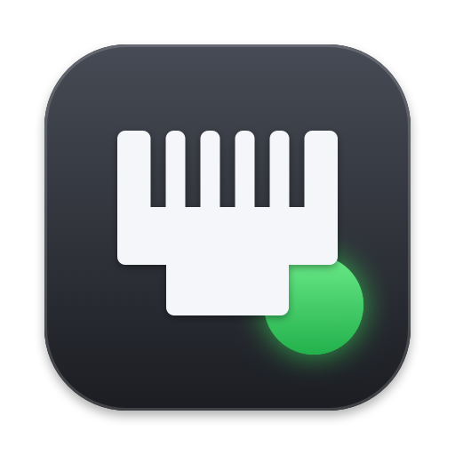
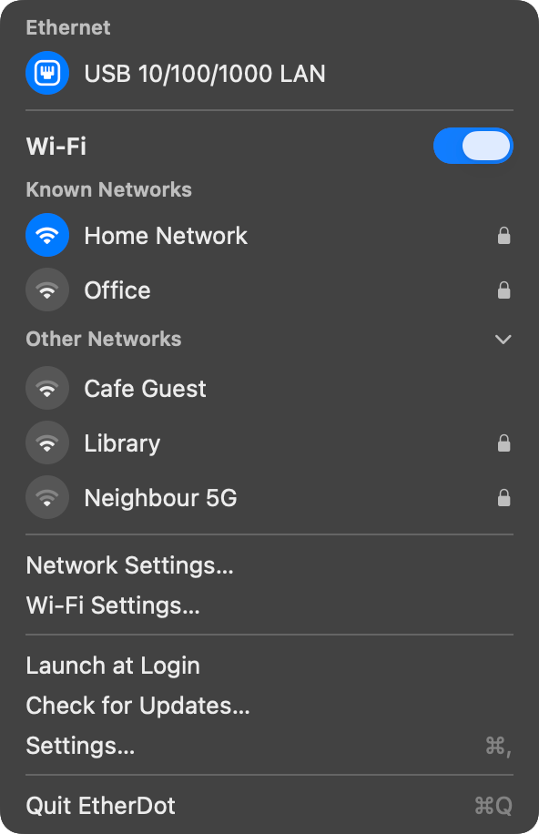
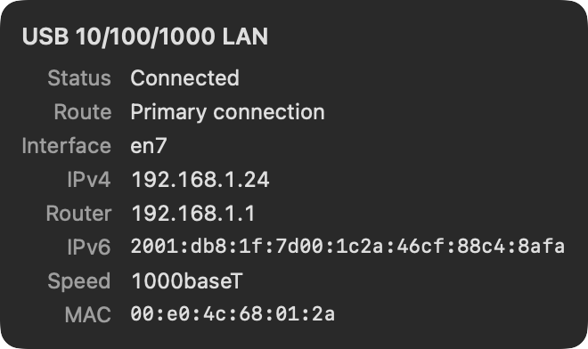
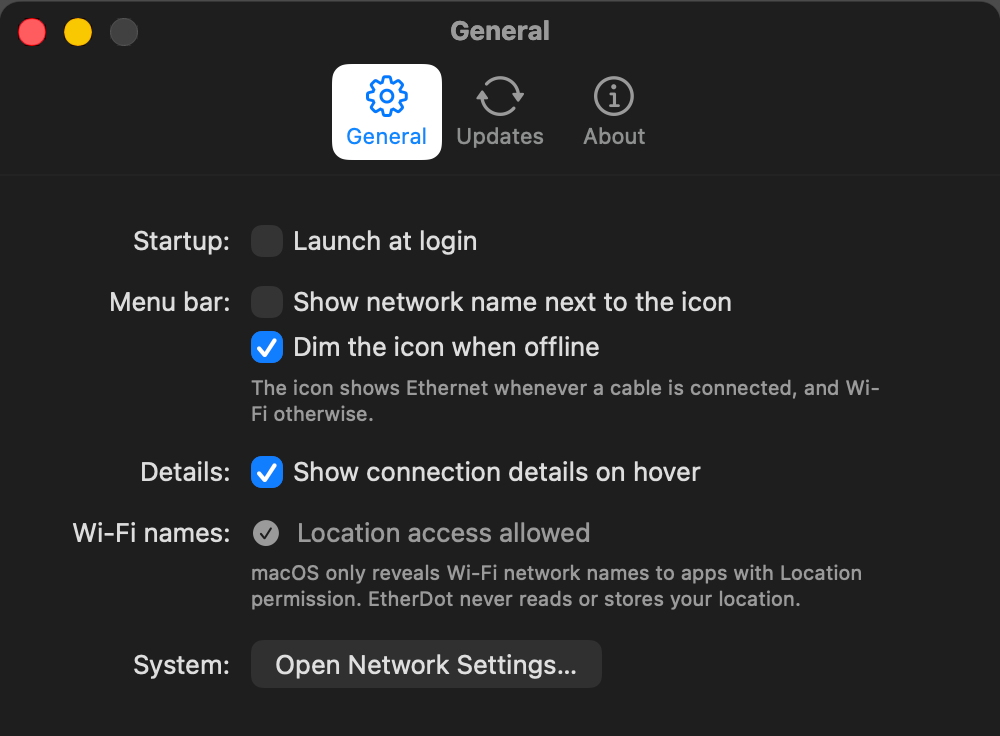
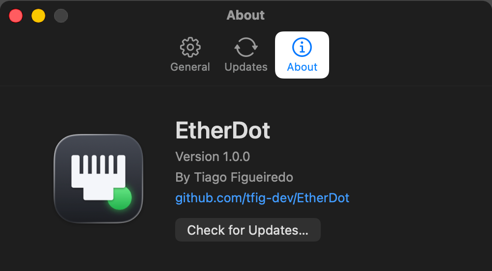

<p align="center">
  
</p>

<h1 align="center">EtherDot</h1>

<p align="center">
  A small macOS menu bar app that shows, at a glance, whether you are on Ethernet or Wi-Fi<br>
  and which network you are actually connected to.
</p>

<p align="center">
  <a href="https://github.com/tfig-dev/EtherDot/releases/latest"></a>
  <a href="https://github.com/tfig-dev/EtherDot/actions/workflows/ci.yml"></a>
  
</p>

<p align="center">
  
  &nbsp;&nbsp;
  
</p>

macOS shows a Wi-Fi icon in the menu bar even when your traffic is going over a cable. EtherDot fixes
that: plug in Ethernet and the icon becomes an RJ45 port; unplug it and it turns back into the Wi-Fi icon.

## Features

- **Honest menu bar icon.** Ethernet connected: an RJ45 port. Only Wi-Fi connected: the standard Wi-Fi
  icon. Ethernet always takes priority, the same rule macOS Network Settings uses.
- **Real network names.** The Wi-Fi network name (SSID) and the Ethernet network service name
  (for example "USB 10/100/1000 LAN"), never just "Wi-Fi" or "Ethernet".
- **Details on hover.** Rest the pointer on a connection to see status, interface, IP addresses, router,
  link speed, signal, channel and MAC address in a popover beside the menu, on whichever side of the
  screen has the most room.
- **A familiar Wi-Fi section.** On/off switch, known networks, other networks and a shortcut to Wi-Fi
  Settings, laid out like the system Wi-Fi menu.
- **Launch at login**, from the menu or from Settings.
- **Built-in updates** through [Sparkle](https://sparkle-project.org), served from this repository's
  GitHub Releases.
- **Compact and native.** One small menu, a three-tab Settings window, no Dock icon.

Coming soon in v1.1:

- 🔜 **Network adapters**: detect USB hubs, docks and Wi-Fi dongles as they are plugged in and add them to the app.
- 🔜 **Live traffic**: upload and download speed, refreshed every second, in the menu and optionally next to the icon.

<p align="center">
  
  
</p>

## Requirements

- macOS 13 Ventura or later
- Apple silicon or Intel (the app is a universal binary)

## Installation

### Download the DMG

1. Download `EtherDot-x.y.z.dmg` from the [latest release](https://github.com/tfig-dev/EtherDot/releases/latest).
2. Open the DMG and drag **EtherDot** onto the **Applications** folder.
3. Launch EtherDot from Applications. It appears in the menu bar; there is no Dock icon.

### Homebrew

```bash
brew tap tfig-dev/etherdot https://github.com/tfig-dev/EtherDot
```

```bash
brew install --cask etherdot
```

The cask lives in this repository (`Casks/etherdot.rb`) and is updated by the release pipeline.

### First launch (unsigned build)

EtherDot is currently distributed **without an Apple Developer ID signature**, so macOS blocks the
first launch with a message that the app cannot be verified. This is expected. To open it:

- **macOS 13 and 14:** in Applications, right-click (or Control-click) EtherDot, choose **Open**, then
  **Open** again in the dialog.
- **macOS 15 and later:** try to open the app once, then go to **System Settings › Privacy & Security**,
  scroll to the Security section and click **Open Anyway** next to the EtherDot message. Confirm with
  your password or Touch ID.

You only need to do this once. If you prefer the terminal, this removes the quarantine flag instead:

```bash
xattr -dr com.apple.quarantine /Applications/EtherDot.app
```

### Wi-Fi network names

macOS only tells an app the name of the Wi-Fi network if the app has Location permission. Choose
**Show Wi-Fi Network Names…** in the menu (or **Settings › General › Allow Location Access…**) and
approve the prompt. EtherDot never reads or stores your location; without the permission everything
else still works and the Wi-Fi row is labelled "Wi-Fi network".

## Updates

EtherDot checks for updates once a day and whenever you choose **Check for Updates…** (in the menu or in
**Settings › Updates** and **About**). It reads the `appcast.xml` attached to the latest GitHub Release,
downloads the new DMG, verifies its EdDSA signature against the public key built into the app and
installs it. You can turn automatic checks off, or turn automatic installation on, in **Settings › Updates**.

If you installed with Homebrew, `brew upgrade --cask etherdot` works too.

## Building from source

You need macOS 13 or later with Xcode 16 or later, or just the Xcode Command Line Tools.

```bash
git clone https://github.com/tfig-dev/EtherDot.git
cd EtherDot
./scripts/test.sh          # unit tests
./scripts/build-app.sh     # builds build/EtherDot.app (universal, ad-hoc signed)
open build/EtherDot.app
```

Optional extras:

```bash
ARCHS=arm64 ./scripts/build-app.sh   # faster, single-architecture build
brew install create-dmg && ./scripts/make-dmg.sh   # dist/EtherDot-<version>.dmg
swift run IconGenerator .            # regenerate the app icon, menu bar icon and DMG background
```

### Project layout

| Path | What it is |
| --- | --- |
| `Sources/EtherDotCore` | Pure logic (connection state, icon priority, labels, popover placement) and the icon artwork |
| `Sources/EtherDot` | The app: network monitoring, menu, hover popover, Settings window, Sparkle, launch at login |
| `Sources/IconGenerator` | Renders `Assets/` (AppIcon asset catalog, `.icns`, menu bar template) and the DMG background |
| `Tests/EtherDotCoreTests` | Unit tests |
| `Support/` | `Info.plist` template and entitlements |
| `scripts/` | Build, test, DMG and cask scripts used locally and by CI |
| `Casks/etherdot.rb` | Homebrew cask |
| `VERSION` | The version number, in one place |

## Making a release

The version lives in the `VERSION` file and nowhere else. Releases follow
[semantic versioning](https://semver.org).

1. Change `VERSION` (for example to `1.1.0`), commit and push to `main`.
2. Tag and push:

   ```bash
   git tag v1.1.0 && git push origin v1.1.0
   ```

3. The **Release** workflow then runs the tests, builds the universal app, signs and notarizes it when
   signing secrets are configured (otherwise it ships an unsigned DMG), packages the DMG, generates and
   signs the Sparkle appcast, publishes a GitHub Release with auto-generated notes, and updates the
   Homebrew cask.

The tag must match `VERSION`; the workflow stops if it does not.

### Secrets

All signing material lives in **GitHub › Settings › Secrets and variables › Actions**, never in the repository.

| Secret | Needed for | Where it comes from |
| --- | --- | --- |
| `SPARKLE_PRIVATE_KEY` | Signed appcast (in-app updates) | `generate_keys --account EtherDot -x key.txt` from Sparkle, paste the file's contents |
| `MACOS_CERTIFICATE_P12` | Developer ID signing | Base64 of the exported "Developer ID Application" certificate (`base64 -i cert.p12 \| pbcopy`) |
| `MACOS_CERTIFICATE_PASSWORD` | Developer ID signing | The password chosen when exporting the `.p12` |
| `APPSTORE_API_KEY_P8` | Notarization | Contents of the App Store Connect API key file `AuthKey_XXXXXXXXXX.p8` |
| `APPSTORE_API_KEY_ID` | Notarization | The key's ID in App Store Connect |
| `APPSTORE_API_ISSUER_ID` | Notarization | The Issuer ID shown above the keys list |

Only `SPARKLE_PRIVATE_KEY` is needed for unsigned releases. Without the certificate secrets the pipeline
still publishes an unsigned DMG; without the Sparkle key it publishes the DMG but no appcast.

## Author

Made by [Tiago Figueiredo](https://github.com/tfig-dev).
